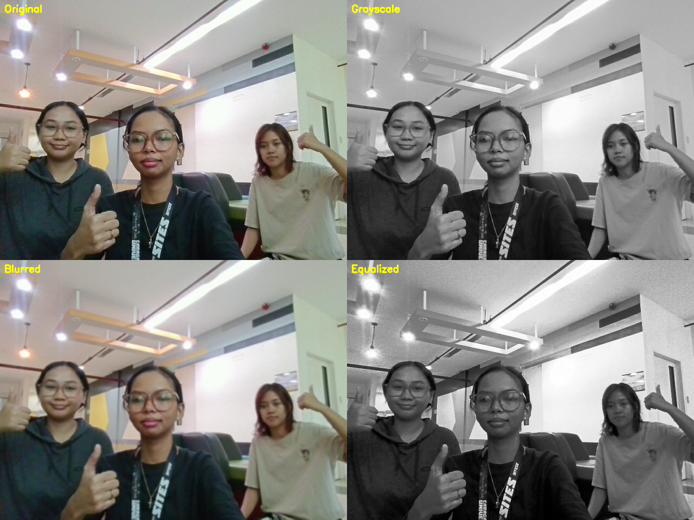
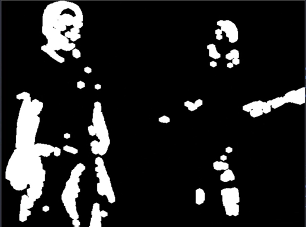
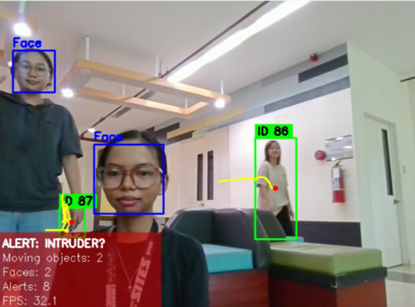
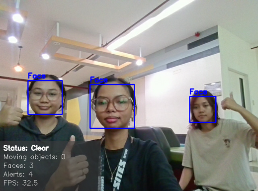
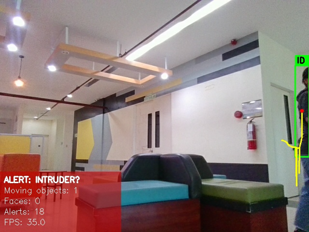
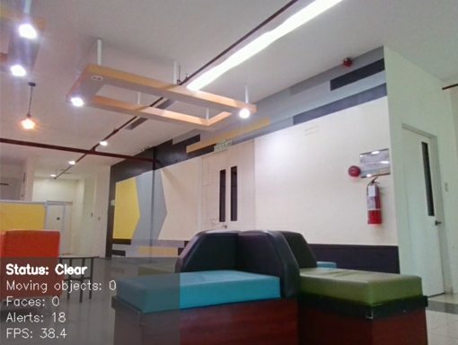

# KITA KITA: A Motion-Triggered Security Camera with Face Detection

KITA KITA is a Python + OpenCV application that watches a room through your webcam. When something moves, it tracks the object, checks for faces, raises an on-screen alert, and saves a time-stamped snapshot as evidence.

## Features

1. **Motion detection**: background subtraction (MOG2), thresholding, morphology and contours find moving objects.
2. **Object tracking**: a centroid tracker gives each moving object an ID number and draws a trail behind it.
3. **Face detection**: a Haar cascade classifier detects and counts frontal faces.
4. **Alerts and evidence**: when motion lasts long enough, the status panel turns red and an annotated snapshot is saved to `alerts/`.

### Image-processing topics used

| Topic | What the code does |
|---|---|
| Image operations | Resize, grayscale, Gaussian blur, histogram equalization |
| Image segmentation | MOG2 mask, threshold, morphological open/dilate, contours |
| Haar cascade | Frontal-face detection (`scaleFactor`, `minNeighbors`) |
| Motion and tracking | Centroid tracker with IDs and trails |

## Requirements

- Python 3.8 or newer
- A working webcam
- `opencv-python` **version 4.x** (not 5.x)
- `numpy`

> **Important:** OpenCV 5.x removed the Haar `CascadeClassifier` from the main package, so the app will not run with it. Use OpenCV 4.x.

## Setup

1. **Put the files in a folder**, for example `smart-room-monitor/`, with `smart_room_monitor.py` inside.

2. **(Recommended) Create a virtual environment:**

   ```bash
   python -m venv venv

   # Windows
   venv\Scripts\activate

   # macOS / Linux
   source venv/bin/activate
   ```

3. **Install the dependencies:**

   ```bash
   pip install "opencv-python<5" numpy
   ```

   If you already have OpenCV 5.x installed, replace it first:

   ```bash
   pip uninstall -y opencv-python
   pip install "opencv-python<5"
   ```

## Running the application

```bash
python smart_room_monitor.py
```

This opens the default webcam (camera `0`) in a window called **Smart Room Monitor**.

To use a different camera, pass its index:

```bash
python smart_room_monitor.py --source 1
```

### What to expect

1. **Calibration (about 60 frames):** the status panel says `CALIBRATING...` while the app learns the empty background. Keep the scene still and clear of people during this time.
2. **Monitoring:** the panel says `Status: Clear`. Moving objects get a green box, an ID tag and a yellow trail. Faces get a blue box labelled `Face`.
3. **Alert:** if motion lasts 5 frames in a row, the panel turns red and shows `ALERT: INTRUDER?`. A snapshot is saved to `alerts/` (at most once every 5 seconds).

The panel in the bottom-left corner shows the current status, number of moving objects, number of faces, total alerts raised and FPS.

## Keyboard controls

Click the video window first so it receives the key presses.

| Key | Action |
|---|---|
| `q` | Quit |
| `r` | Reset the background model and tracker (re-calibrates) |
| `d` | Show / hide the motion mask window |
| `s` | Save a manual snapshot to `alerts/` |
| `f` | Save report figures (fig1 / fig2 / fig3) to `figures/` |
| `1` | Log a test result: correct detection |
| `2` | Log a test result: false alarm |
| `3` | Log a test result: miss |

When you quit, a session summary is printed in the terminal: average FPS, alerts raised, and your logged test results.

## Output folders

Both folders are created automatically in the directory you run the script from.

- `alerts/`: evidence snapshots, named like `alert_20261013_142530_faces1.jpg`, plus manual snapshots (`manual_...jpg`).
- `figures/`: report figures saved with the `f` key:
  - `fig1_preprocess_*.png`: original, grayscale, blurred and equalized frames in one montage
  - `fig2_mask_*.png`: the motion mask
  - `fig3_output_*.png`: the final annotated output

## Tuning

All adjustable values are in the **SETTINGS** block at the top of `smart_room_monitor.py`.

| Setting | Default | Effect |
|---|---|---|
| `CAMERA_INDEX` | `0` | Default webcam used when `--source` is not given |
| `FRAME_WIDTH` | `640` | Frames are resized to this width for speed |
| `MIN_BLOB_AREA` | `300` | Ignores tiny specks before merging |
| `MERGE_GAP` | `40` | Boxes closer than this (pixels) merge into one object |
| `MIN_AREA` | `1500` | Minimum size of a merged box |
| `WARMUP_FRAMES` | `60` | Frames used to learn the background |
| `MIN_HITS` | `5` | Frames an object must be seen before it gets an ID |
| `MAX_DISAPPEARED` | `25` | Frames a lost object is remembered |
| `MAX_DISTANCE` | `120` | Maximum pixel jump to count as the same object |
| `TRAIL_LENGTH` | `30` | Number of past positions drawn as the trail |
| `MIN_MOTION_FRAMES` | `5` | Frames of continuous motion needed to raise an alert |
| `SNAPSHOT_COOLDOWN` | `5` | Seconds between saved alert snapshots |
| `FACE_SCALE_FACTOR` | `1.1` | Smaller is slower but more thorough |
| `FACE_MIN_NEIGHBORS` | `5` | Higher gives fewer false faces but more misses |
| `FACE_MIN_SIZE` | `(60, 60)` | Ignores faces smaller than this |
| `FACE_EVERY_N_FRAMES` | `3` | Runs face detection every Nth frame to save time |

## Sample output
**Figure 1.** Original frame vs. preprocessed versions (grayscale, blurred, equalized).


**Figure 2.** Motion mask after MOG2, thresholding and morphological cleaning (white = moving pixels).


**Figure 3.** Final output with bounding boxes, IDs, trails and ALERT panel (moving objects).


**Figure 4.** Face detection results with the face count displayed in the panel (no motion).


**Figure 5.** Evidence snapshot saved automatically in `alerts/` at the moment the alert was raised.


**Figure 6.** Status remains “Clear” when no motion is detected.


The FPS shown in the screenshots is the speed of the computer used to make
them; your own value will differ.

## Limitations

* **Sudden lighting changes** (a light switched on) can briefly look like
  motion until the background model adapts; press `r` after big changes.
* **Overlapping people** merge into one box, and IDs can swap or change.
* **Backlight, side faces and tilted heads** are often missed, because the
  Haar cascade was trained on frontal faces.
* **Motionless people** are slowly absorbed into the background, so the box
  and alert disappear even though the person is still there.
* **Dark or sharp shadows** may be counted as part of a moving object.
* **Small or far-away people** can fall under the minimum box/face size.
* Haar cascades sometimes produce **false faces** (posters, patterns).
* The camera must stay still.
* The program saves pictures of people, so a real deployment needs a privacy
  notice and controlled access to the `alerts/` folder.

## Troubleshooting

- **"Cannot open webcam 0":** another app may be using the camera, or the camera has a different index. Try `--source 1` (or `2`), and check your operating system's camera permissions.
- **"OpenCV has no Haar CascadeClassifier":** you have OpenCV 5.x. Install `opencv-python<5` as shown in Setup.
- **Constant false alerts:** the background may not have settled. Press `r` and keep the scene still during calibration, or raise `MIN_AREA` and `MIN_MOTION_FRAMES`. Changing lighting (flickering lights, sunlight through a window) can also trigger motion.
- **Faces not detected:** Haar cascades work best on well-lit, front-facing faces. Face the camera, improve the lighting, or lower `FACE_MIN_NEIGHBORS`.
- **Low FPS:** lower `FRAME_WIDTH` or increase `FACE_EVERY_N_FRAMES`.
- **Key presses do nothing:** click the video window so it has focus.

## Project structure

```
smart-room-monitor/
├── smart_room_monitor.py   # the application
├── README.md               # this file
├── requirements.txt        # dependencies
├── venv/                   # optional (but Recommended)
├── alerts/                 # created at runtime: evidence snapshots
└── figures/                # created at runtime: report figures
```